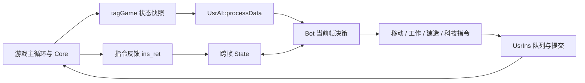

# 代码架构与阅读路线

## 从一帧游戏到一批指令

`MainWidget.cpp` 负责主要界面逻辑与胜负判定；`Core.cpp`、`Core_List.cpp`、`Core_CondiFunc.cpp` 负责动作执行、状态更新和前置条件检查。`Map.cpp`、`MapRotation.cpp` 处理地图；`Farmer.cpp`、`Army.cpp`、`Building.cpp` 等定义单位与建筑行为。`AI.cpp` 和 `ai.h` 是框架接口；`UsrAI.cpp` 实现玩家策略，`enemyai.cpp` 实现敌方策略。

阅读顺序建议是：`UsrAI.h` → `ai.h` → `GlobalVariate.h` 的快照/指令结构 → `UsrAI::processData()` → 感兴趣的策略模块 → Core 中对应的执行与校验路径。单看按钮文案或枚举名称容易误解实际规则，成本、射程、建造前提应追到实现。

## 学生策略内部

主要实现放在 `UsrAI.cpp` 的匿名命名空间内，减少对框架接口的影响。

| 结构/模块 | 职责 | 阅读时重点 |
| --- | --- | --- |
| `State` | 跨帧保存单位任务、敌情记忆、路径与阶段 | 何时清理死亡单位、如何避免过期目标 |
| `Bot` | 当前快照、资源预算、查询和动作安排 | 决策预算与真正库存的区别 |
| `Pos` / `Cost` | 坐标与各资源成本 | 定点数转换、帧数与秒的换算 |
| `Order` / `Pending` | 指令意图、待反馈命令和超时恢复 | 一个单位每轮避免被互相覆盖的命令 |
| `Tech` / `Enemy` | 科技进度、已知敌军信息 | 不能把暂时看不见视作不存在 |
| 经济规划 | 村民、建筑、资源和时代升级 | 当前短板、预算预留、建筑优先级 |
| 战斗控制 | 防守、反攻、增援、塔战和祭司 | 全局阶段与单位动作的协调 |

策略用 `PhaseDefend`、`PhaseAdvance`、`PhaseConverting` 等阶段保持整体方向。高频战术与较低频经济规划分开执行，避免每帧都重新分配全部农民，但仍需处理死亡、资源耗尽和命令失败。

## 接口上容易错的地方

1. 单位使用稳定的 `SN` 标识；数组下标只属于当前快照，不要跨帧保存后继续访问。
2. 状态读取与指令生效存在时间差。不要看到一次空闲就立刻推翻有效的建造、放置或采集任务。
3. `AddToIns()` 返回引擎分配的指令编号。反馈关联必须使用实际返回值，不能假设编号从零连续或与列表下标相同。
4. 当前代码调用框架的显式提交接口。迁移工程时要核对基类实现与服务器协议，避免只改策略却沿用不兼容的提交方式。
5. 框架大量使用定点数类型。需要浮点计算时明确转换，避免构造歧义、精度和旧编译器兼容错误。
6. 路径可达性与欧氏距离不是一回事。河流、地形高度和建筑碰撞都会影响实际通路。

更完整的字段说明见 [AI接口使用指南](../AI接口使用指南.md)，建造前提见 [建造操作索引](../村民建造操作清单.md)。
